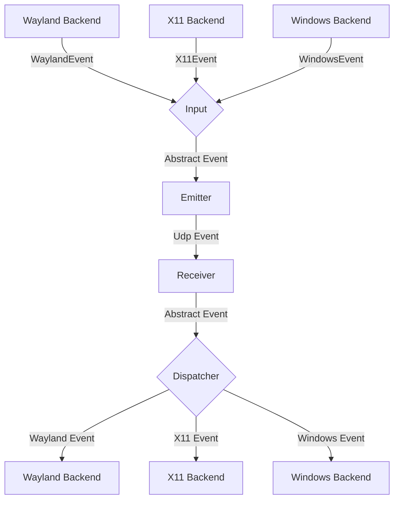
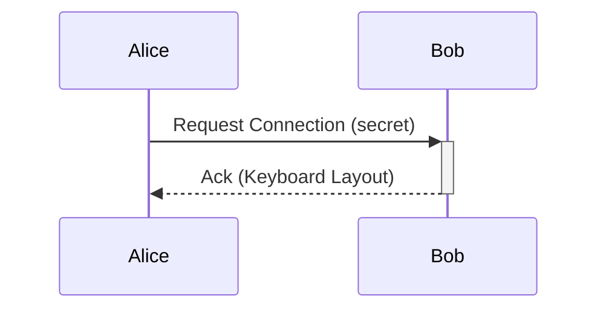

# General Software Architecture

## Events

Each instance of lan-mouse can emit and receive events, where
an event is either a mouse or keyboard event for now.

The general Architecture is shown in the following flow chart:

### Input
The input component is responsible for translating inputs from a given backend
to a standardized format and passing them to the event emitter.

### Emitter
The event emitter serializes events and sends them over the network
to the correct client.

### Receiver
The receiver receives events over the network and deserializes them into
the standardized event format.

### Dispatcher
The dispatcher component takes events from the event receiver and passes them
to the correct backend corresponding to the type of client.

## Requests

### Local frontend/daemon lifecycle (IPC crate 0.4)

The local newline-delimited JSON protocol adds `Identify` and
`Shutdown { pid }` requests, with `InstanceInfo { pid }` and `ShuttingDown`
events. `Identify` lets the launcher verify that its newly spawned daemon owns
the endpoint. `Shutdown` is ignored unless its target PID matches the daemon.
The launcher retains that verified connection for GTK instead of reconnecting
after the startup lock is released, and requests a fresh state snapshot after
the identity exchange.
Before exiting, the daemon broadcasts `ShuttingDown`, then runs capture,
emulation, and DNS termination. Frontends quit on that event and never respawn
the daemon on disconnect. Lifecycle notifications use a bounded write timeout
so a slow frontend cannot indefinitely delay input cleanup.

These additions bump `lan-mouse-ipc` from 0.3 to 0.4. JSON names of existing
requests/events are unchanged. Older frontends cannot decode new lifecycle
events, so launch replacement should stop the old frontend and daemon together;
older daemons that cannot identify themselves use verified process shutdown and
an explicit force-close choice when graceful shutdown is unavailable. The input
network protocol is unchanged. Local IPC is an existing local control interface;
process identity checks do not turn it into an authenticated network API.

// TODO this currently works differently

Aside from events, requests can be sent via a simple protocol.
For this, a simple tcp server is listening on the same port as the udp
event receiver and accepts requests for connecting to a device or to
request the keymap of a device.

## Problems
The general Idea is to have a bidirectional connection by default, meaning
any connected device can not only receive events but also send events back.

This way when connecting e.g. a PC to a Laptop, either device can be used
to control the other.

It needs to be ensured, that whenever a device is controlled the controlled
device does not transmit the events back to the original sender.
Otherwise events are multiplied and either one of the instances crashes.

To keep the implementation of input backends simple this needs to be handled
on the server level.

## Device State - Active and Inactive
To solve this problem, each device can be in exactly two states:

Either events are sent or received.

This ensures that
- a) Events can never result in a feedback loop.
- b) As soon as a virtual input enters another client, lan-mouse will stop receiving events,
which ensures clients can only be controlled directly and not indirectly through other clients.

