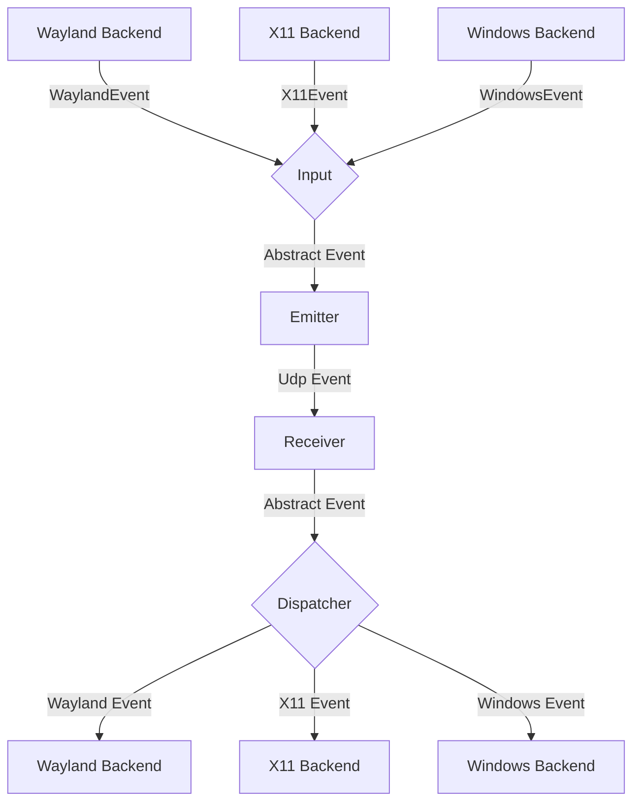
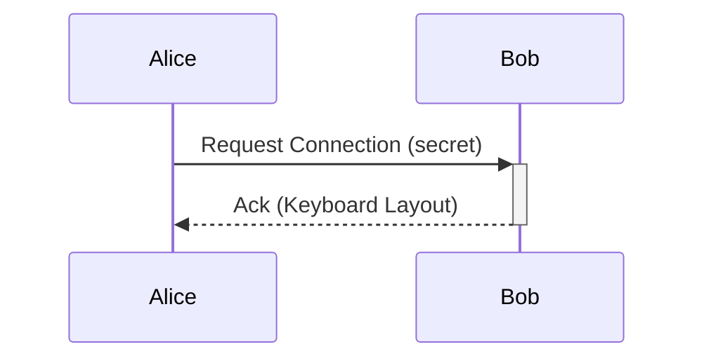

# General Software Architecture

## Events

Each instance of lan-mouse can emit and receive events, where
an event is either a mouse or keyboard event for now.

The general Architecture is shown in the following flow chart:

### Input
The input component is responsible for translating inputs from a given backend
to a standardized format and passing them to the event emitter.

### Emitter
The event emitter serializes events and sends them over the network
to the correct client.

### Receiver
The receiver receives events over the network and deserializes them into
the standardized event format.

### Dispatcher
The dispatcher component takes events from the event receiver and passes them
to the correct backend corresponding to the type of client.

## Requests

// TODO this currently works differently

Aside from events, requests can be sent via a simple protocol.
For this, a simple tcp server is listening on the same port as the udp
event receiver and accepts requests for connecting to a device or to
request the keymap of a device.

## Clipboard protocol v1

Windows and macOS support opt-in text synchronization on control switches.
The service starts a separate TLS-over-TCP listener on the input listener's port
number when `[clipboard] mode = "on-switch"`. TLS 1.3 requires a client certificate
from `authorized_fingerprints`; outgoing requests pin the destination's complete
certificate fingerprint from `clipboard.peers`. Handshake signatures are verified
by rustls. ALPN is `lan-mouse-clipboard/1`. This channel does not depend on DTLS
server-certificate verification and does not change the existing input protocol.

After an input peer acknowledges entry, the controller sends a fresh clipboard
snapshot. On release, it requests the remote clipboard. Neither operation
intercepts paste shortcuts. GTK does not need to be open. A dedicated OS worker
serializes clipboard access and performs bounded read retries on contention;
network tasks remain independent of input capture and emulation.

Each TCP connection carries one request. Integers use network byte order:

| Field | Encoding |
|---|---|
| Protocol/version | Eight bytes: `LMCLIP01` |
| Operation | One byte: 1 = push, 2 = pull |
| Sender session | 16 random bytes, generated per clipboard service instance |
| Sequence | Monotonically increasing u64 within the session |
| Text (push body / pull response) | u32 byte length followed by UTF-8; `0xffffffff` means absent |
| Push response | One byte: 1 = applied, 0 = skipped |

Receivers reject unsupported versions/operations, malformed UTF-8, truncated
frames, and lengths above 1 MiB before allocating a payload buffer. Empty text
is a valid frame; an OS clipboard without text uses the absent marker. Requests
have a five-second timeout, at most eight inbound tasks, and a bounded worker
queue. Request ordering tracks at most 128 peer identities and 64 retired
sessions per identity. Lower/duplicate sequences and retired sessions are
rejected; a newer request supersedes an older push still receiving its payload.

A local switch epoch invalidates queued writes from cancelled work. Native
clipboard generations (Windows sequence number / macOS pasteboard change count)
prevent a received transfer from overwriting a local copy made while that
transfer was being received. Check and write are adjacent OS operations, not an
atomic compare-and-swap. Since transfers are asynchronous, immediate paste is
not delayed until synchronization completes. Protocol changes must introduce a
new version and ALPN identifier. Clipboard contents must not appear in logs.

### Manual clipboard verification

Run a Windows/macOS pair with clipboard sharing enabled and fingerprints pinned.
Test both Windows-controlled-Mac and Mac-controlled-Windows configurations:

1. Copy ASCII, multiline text, Unicode, and emoji; switch and paste through both
   keyboard shortcuts and application menus.
2. Copy new text on the controlled computer; return by screen edge and release
   bind and verify the controller receives it.
3. Repeat switches rapidly, copy locally during a transfer, disconnect, disable
   sharing in the config, and reconnect. Verify obsolete work does not replace
   newer clipboard changes and input remains responsive.
4. Try images, files, an empty clipboard, and text above 1 MiB. Verify unsupported
   content leaves the destination untouched and errors contain no clipboard text.
5. Try an unauthorized controller, a wrong destination pin, and an older peer.
   Clipboard transfer must fail without leaking contents or preventing ordinary
   input sharing. Verify held modifiers release normally on disconnect.

Automated tests use in-memory clipboards and real TLS handshakes, leaving the
developer's system clipboard untouched. Native clipboard and cross-platform
behavior still require the manual checks above.

## Problems
The general Idea is to have a bidirectional connection by default, meaning
any connected device can not only receive events but also send events back.

This way when connecting e.g. a PC to a Laptop, either device can be used
to control the other.

It needs to be ensured, that whenever a device is controlled the controlled
device does not transmit the events back to the original sender.
Otherwise events are multiplied and either one of the instances crashes.

To keep the implementation of input backends simple this needs to be handled
on the server level.

## Device State - Active and Inactive
To solve this problem, each device can be in exactly two states:

Either events are sent or received.

This ensures that
- a) Events can never result in a feedback loop.
- b) As soon as a virtual input enters another client, lan-mouse will stop receiving events,
which ensures clients can only be controlled directly and not indirectly through other clients.

