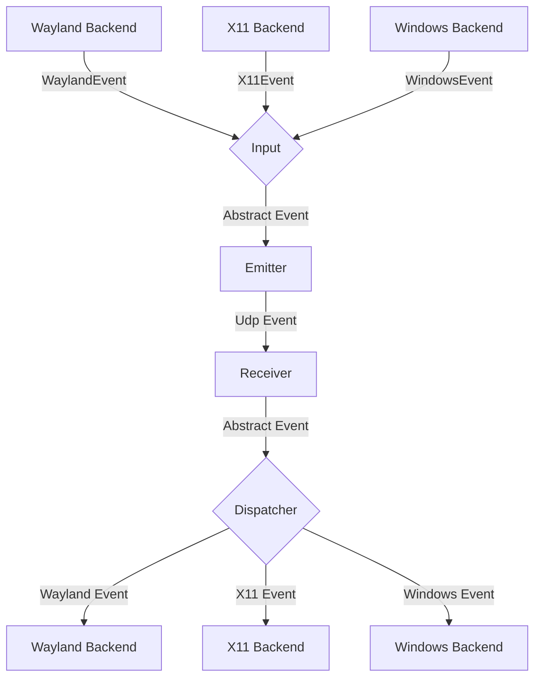
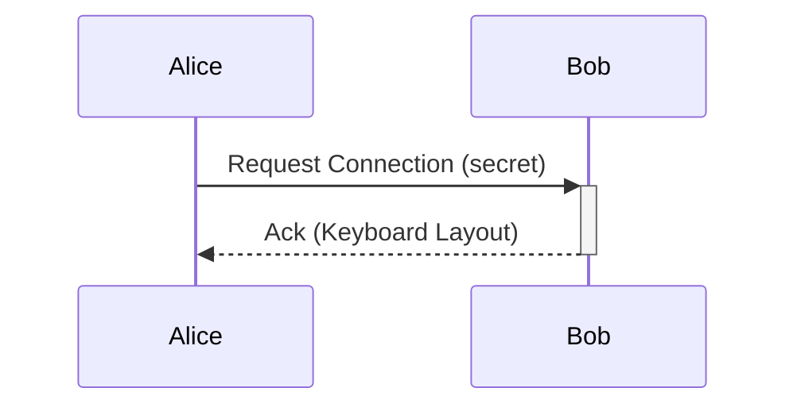

# General Software Architecture

## Events

Each instance of lan-mouse can emit and receive events, where
an event is either a mouse or keyboard event for now.

The general Architecture is shown in the following flow chart:


### Input
The input component is responsible for translating inputs from a given backend
to a standardized format and passing them to the event emitter.

### Emitter
The event emitter serializes events and sends them over the network
to the correct client.

### Receiver
The receiver receives events over the network and deserializes them into
the standardized event format.

### Dispatcher
The dispatcher component takes events from the event receiver and passes them
to the correct backend corresponding to the type of client.


## Requests

### Local frontend/daemon lifecycle (IPC crate 0.4)

The local newline-delimited JSON protocol adds `Identify` and
`Shutdown { pid }` requests, with `InstanceInfo { pid }` and `ShuttingDown`
events. `Identify` lets the launcher verify that its newly spawned daemon owns
the endpoint. `Shutdown` is ignored unless its target PID matches the daemon.
The launcher retains that verified connection for GTK instead of reconnecting
after the startup lock is released, and requests a fresh state snapshot after
the identity exchange.
Before exiting, the daemon broadcasts `ShuttingDown`, then runs capture,
emulation, and DNS termination. Frontends quit on that event and never respawn
the daemon on disconnect. Lifecycle notifications use a bounded write timeout
so a slow frontend cannot indefinitely delay input cleanup.

These additions bump `lan-mouse-ipc` from 0.3 to 0.4. JSON names of existing
requests/events are unchanged. Older frontends cannot decode new lifecycle
events, so launch replacement should stop the old frontend and daemon together;
older daemons that cannot identify themselves use verified process shutdown and
an explicit force-close choice when graceful shutdown is unavailable. The input
network protocol is unchanged. Local IPC is an existing local control interface;
process identity checks do not turn it into an authenticated network API.

// TODO this currently works differently

Aside from events, requests can be sent via a simple protocol.
For this, a simple tcp server is listening on the same port as the udp
event receiver and accepts requests for connecting to a device or to
request the keymap of a device.



## Problems
The general Idea is to have a bidirectional connection by default, meaning
any connected device can not only receive events but also send events back.

This way when connecting e.g. a PC to a Laptop, either device can be used
to control the other.

It needs to be ensured, that whenever a device is controlled the controlled
device does not transmit the events back to the original sender.
Otherwise events are multiplied and either one of the instances crashes.

To keep the implementation of input backends simple this needs to be handled
on the server level.

## Device State - Active and Inactive
To solve this problem, each device can be in exactly two states:

Either events are sent or received.

This ensures that
- a) Events can never result in a feedback loop.
- b) As soon as a virtual input enters another client, lan-mouse will stop receiving events,
which ensures clients can only be controlled directly and not indirectly through other clients.


## Peer authentication

Every device has a self-signed certificate (`lan-mouse.pem`) and is
identified by the sha256 fingerprint of it, written as lowercase,
colon-separated hex (`lan_mouse_ipc::normalize_fingerprint` accepts other
spellings and converts them).

**Incoming** connections require exactly one client certificate whose
fingerprint is in `authorized_fingerprints` (`src/listen.rs`). The check runs
before the peer is authorized, so any other certificate count is rejected
without panicking.

**Outgoing** connections compare the server certificate with the client's
pinned `fingerprint` (`src/connect.rs`):

- `insecure_skip_verify` stays set because self-signed certificates cannot pass
  CA chain validation. webrtc-dtls still verifies the server's key-exchange
  signature against the presented certificate and then calls
  `verify_peer_certificate`, so a fingerprint match proves the peer holds the
  pinned key.
- Exactly one certificate must be presented. A handshake that completes
  without the check running is closed.
- An unpinned client pins the certificate of its first successful handshake
  (trust on first use). This is a known limit: whoever answers first, on any
  of the client's addresses, is trusted. Confirming before pinning would close
  it.
- A mismatch fails the handshake with `PeerIdentityError::Mismatch`. The
  connection layer reports it to the service as a `PeerIdentityEvent`, which
  becomes `FrontendEvent::PeerIdentityRejected`. Repeats for the same
  certificate are suppressed for 30 seconds, because each crossing retries the
  connection.
- A new pin is saved to the config file. Pins are never replaced
  automatically. `FrontendRequest::UpdateFingerprint` sets or clears one.
- A handshake result is applied only if the client's target (hostname,
  addresses, port and pin) is unchanged when the handshake completes.
  Otherwise the connection is closed and retried. This covers clients that
  are edited, or removed with their handle reused by another client
  (including by a config reload), while the handshake is in flight.
- Each open connection keeps the fingerprint it was established with. If the
  pin changes to a different certificate while connected, the next send closes
  the connection and reconnects under the new pin. Clearing the pin keeps the
  open connection, and the next connection pins again.
- An invalid fingerprint in the config file is kept as written and logged. It
  can never match, so the client fails closed instead of being re-pinned.

The two trust lists are separate: a device used in both directions appears in
`authorized_fingerprints` and as a client pin.

## Relative edge position (Windows and macOS)

Crossings preserve the cursor's relative position along the edge, including
return crossings from an incoming connection. Leaving the right edge 10% from
the bottom enters the left edge 10% from the bottom. Top/bottom transitions
preserve relative width. Resolution and desktop origin can differ.

Each device uses the bounding extent of its whole desktop, in its native cursor
coordinate system (Windows physical desktop pixels, with the capture thread
per-monitor DPI aware so scaled displays match the hook coordinates; macOS
logical coordinates).
The coordinate is measured from the top or left and quantized to a u16. Entry
is inset from the edge to prevent an immediate return crossing. For irregular
multi-monitor layouts, a fraction falling into a gap selects the nearest real
segment of the destination's outer edge. Exact corner positions are inset too.

The input protocol crate is version 0.4.0. Enter and Leave retain their original
wire prefix and optionally append a presence byte (1) and a network-order u16
coordinate. Receive buffers are zeroed before each datagram so old packets have
no coordinate. Legacy peers ignore the extra bytes and retain their previous
cursor behavior; both peers need the new build for proportional transitions.
Linux backends retain their existing behavior in this first implementation.
The original entry coordinate is retained through Enter retransmissions, and
receivers position only once per capture session.

Manual verification (not yet performed): on a Windows/macOS pair, test both
control directions and all four edges at 10%, 50%, and 90%; move along the remote
edge before returning and verify the return uses the new fraction. Repeat with
different resolutions, scaling settings, negative monitor origins, monitor
reconfiguration, and gaps. Verify continued movement after handoff retries,
legacy-peer operation, and that held keys release on disconnect/release bind.

Tracked in [fork issue #17](https://github.com/NickReardon/lan-mouse/issues/17).

### Edge-position diagnostics

At the default info log level, `edge-position` messages report each exit,
handoff (including `EnterOnly` return crossings), entry target, and immediate
cursor read-back. Percentages are measured from the top on left/right edges
and from the left on top/bottom edges: 90% from the top means 10% from the bottom.
`requested` is the transmitted fraction, `mapped` includes monitor-gap/corner
clamping, and `actual` is an immediate OS cursor query after positioning.
Coordinates, desktop bounds, and read-back deltas help identify coordinate
scaling differences. A read-back is a snapshot, not proof that later movement
cannot change the cursor position.

To investigate inconsistent placement, collect matching `edge-position` lines
from both computers for an outward crossing and its return. Include the direction,
monitor layout/scaling, and whether the cursor drifts after entry. The reported
downward drift remains under investigation; these diagnostics do not change
positioning behavior.

## Cross-machine link test

`tests/link.rs` checks the network path between two machines (for example
Windows and macOS) without touching real input. Each machine runs one daemon
with the `dummy` capture and emulation backends, so stop the regular Lan Mouse
on both machines first. Both machines should build the same commit.

The receiver approves every fingerprint that tries to connect while the test
runs. This is only safe because it uses the dummy emulation backend.

Start the receiver first:

```sh
LAN_MOUSE_LINK_ROLE=receive cargo test --test link -- --ignored --nocapture
```

Then start the sender, pointing it at the receiver's IP address or hostname:

```sh
LAN_MOUSE_LINK_ROLE=send LAN_MOUSE_LINK_PEER=192.168.1.20 cargo test --test link -- --ignored --nocapture
```

In PowerShell, set the variables first, e.g. `$env:LAN_MOUSE_LINK_ROLE = "send"`.

The receiver passes after 500 input events arrive. The sender passes once the
receiver acknowledges `Enter`, then keeps sending for five seconds. Optional
variables: `LAN_MOUSE_LINK_PORT` (default 4242, used by both sides) and
`LAN_MOUSE_LINK_TIMEOUT_SECS` (default 120). The receiver's firewall must allow
inbound UDP on that port for the test binary (`target/debug/lan-mouse`).

Tracked in [fork issue #44](https://github.com/NickReardon/lan-mouse/issues/44).
